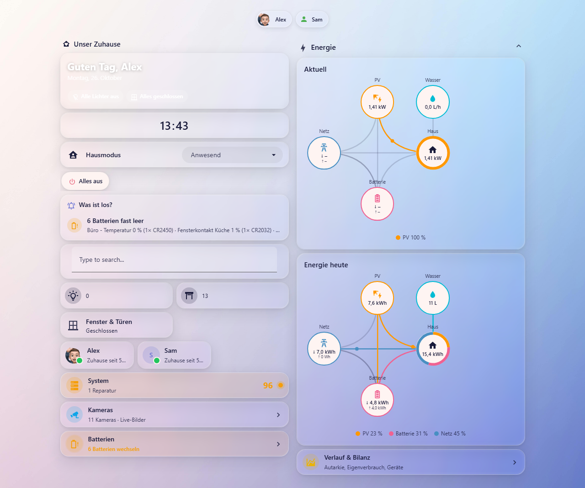

# Unser Zuhause – Dashboard-Strategy für Home Assistant

Eine Dashboard-Strategy, die aus Bereichen, Etagen und dem Energie-Dashboard automatisch ein komplettes Dashboard im Bubble-Card-Design baut. Alles lässt sich über die Dashboard-Einstellungen anpassen, ohne YAML.



## Funktionen

- **Header in zwei Reihen**: Personen (auswählbar, optional nur Anwesende) und weitere Badges
- **Module in einer Layout-Matrix**: Spaltenanzahl frei wählbar, Module per Drag & Drop anordnen oder ausblenden
  - Unser Zuhause (Uhr, Suche, Status-Kacheln, Favoriten)
  - Energie (Energiefluss aktuell und heute)
  - Müll (anfangs nicht dabei, in den Einstellungen per „+ Müll“ hinzufügen)
  - eine Spalte je Etage mit den Räumen als Buttons und Raum-Popups
  - eigene Module, Karten per GUI wie auf normalen Dashboards
- **Einklappbare Module**, auf dem Handy anfangs eingeklappt
- **Eigene Energiefluss-Karte** `uz-energy-flow-card`
  - Quellen aus dem Standard-Energie-Dashboard
  - Netz links, PV oben, Batterie unten, Haus mit Anteils-Ring, Wasser oben, Verbraucher rechts
  - Linien animiert nur, wenn gerade Leistung fließt
- **Echo-Show-Ansicht** für den Echo Show 8 (1280 × 800): alles auf einen Blick ohne Scrollen
  - Kacheln in 3 Spalten per Drag & Drop oder Antippen anordnen und ausblenden: Uhr, Begrüßung, Hausmodus, Szenen, Status, Energie aktuell/heute, „Läuft gerade“, „Was ist los?“, Räume, Kamera, Wetter, Personen, Favoriten, Müll, eigene Module
  - Kamera als Standbild (springt bei Bewegung auf die aktive Kamera)
  - Antippen der Energiekarte öffnet die Energie-Seite
  - Startseite für die gewählten Benutzer (Einstellungen → „Echo Show“), sonst Unterseite `…/echo-show`
- **Label `no_dboard`** an Entität oder Gerät blendet sie überall aus

## Voraussetzungen

Zuerst installieren:

- **[Integration „Unser Zuhause“](https://github.com/SebastianInTheWild/ha-unser-zuhause-integration)**: legt die Sensoren für Lichter, Rollos, Fenster & Türen, Personen zu Hause und den Hausmodus an. Ohne sie fehlen die Status-Kacheln, solange du keine eigenen Sensoren wählst.
- Optional **[Automationen als Blueprints](https://github.com/SebastianInTheWild/ha-unser-zuhause-blueprints)**: Systemwarnungen und Abwesenheits-Check als Push an die Home-Assistant-App.
- **[Unser Zuhause – Karten](https://github.com/SebastianInTheWild/ha-unser-zuhause-cards)**: alle Karten des Dashboards (Energiefluss, Videoüberwachung, System, Zombies …). Ohne das Paket zeigt das Dashboard Fehlerkarten.

Außerdem über HACS:

- [Bubble Card](https://github.com/Clooos/Bubble-Card)
- [search-card](https://github.com/postlund/search-card)
- [trash-card](https://github.com/idaho/hassio-trash-card) (nur für das Müll-Modul)

## Installation über HACS

1. HACS → oben rechts ⋮ → **Benutzerdefinierte Repositories**
2. URL dieses Repositories eintragen, Typ **Dashboard** wählen, hinzufügen
3. „Unser Zuhause Dashboard Strategy“ suchen und herunterladen
4. Browser mit Strg+Shift+R neu laden

## Dashboard anlegen

Einstellungen → Dashboards → **Dashboard hinzufügen** → „Neues Dashboard von Grund auf“. Dann öffnest du das Dashboard und gehst auf ⋮ → **Bearbeiten** → ⋮ → **Rohkonfigurations-Editor**. Dort trägst du ein:

```yaml
strategy:
  type: custom:unser-zuhause
```

Alles Weitere stellst du danach unter **Bearbeiten** im Einstellungsdialog der Strategy ein.

## Energiekarten auf anderen Dashboards

Die beiden Energiekarten gibt es auch einzeln, auf jedem Dashboard:

- **UZ Energiefluss – Aktuell** (`custom:uz-energy-now-card`): aktuelle Leistung mit Akkustand
- **UZ Energiefluss – Heute** (`custom:uz-energy-day-card`): Energie seit Mitternacht mit Anteilen der Quellen

Du findest sie im Kartenauswahl-Dialog unter „Benutzerdefiniert“. Netz, PV, Batterie, Wasser und Geräte holen sie selbst aus dem Energie-Dashboard. Leistungssensoren, Akkustand und Geräte stellst du im Editor der Karte ein.

```yaml
type: custom:uz-energy-now-card
battery_soc: sensor.battery_level
power_grid_in: sensor.import_power
devices: [Wallbox, Heizung]
```

## Module, eigene Module und Pop-ups

In den Einstellungen unter „Module & Pop-ups“ öffnet ein Klick auf einen Eintrag dessen Einstellungen. Karten fügst du wie auf einem normalen Dashboard hinzu: „Karte hinzufügen“ öffnet den gewohnten Dialog von Home Assistant (Kartenauswahl, Suche, „Nach Entität“), danach der Editor mit Vorschau, den der Entwickler der Karte mitliefert. Ein Klick auf eine Karte in der Liste öffnet sie wieder zum Bearbeiten (zum Beispiel der Müll-Editor). YAML brauchst du dafür nicht.

- **Energie**: Editor der Energiekarten
- **Müll**: Karten-Editor (gespeichert in `trash_cards`)
- **Eigene Module** und **Pop-ups**: Titel, Icon und Karten-Editor – zum Beispiel ein Modul „EVCC“ mit der [EVCC Card](https://github.com/mkshb/hass-evcc-card)

Neue Module erscheinen im Layout-Editor und lassen sich in jede Spalte ziehen.

Energie, Müll und die Etagen (bzw. „Räume“) lassen sich unten auf ihrer Seite löschen und oben über „+ <Name>“ wieder hinzufügen. Beim Start sind „Unser Zuhause“, Energie und die Etagen dabei. Die Einstellungen eines gelöschten Moduls bleiben erhalten (Optionen `modules` und `removed_modules`).

Das ganze Dashboard löschst du nur unter Einstellungen → Dashboards; der „Löschen“-Knopf im Einstellungsdialog des Dashboards ist ausgeblendet.

## Einstellungen und Updates

Die Datei enthält keine installationsspezifischen Entitäten. Alles, was du in den Einstellungen festlegst, wird in der Konfiguration deines Dashboards gespeichert, nicht in der Datei. Ein Update über HACS ersetzt nur die Datei, deine Einstellungen bleiben erhalten.

Ohne Einstellungen erkennt die Strategy automatisch:

- Personen (alle `person.*`)
- Etagen und Bereiche
- Netz, PV, Batterie, Wasser und Geräte aus dem Energie-Dashboard

- Status-Kacheln aus der Integration „Unser Zuhause“
- Leistung von Netz, PV und Batterie, wenn im Energie-Dashboard Leistungssensoren hinterlegt sind

Müll (Kalender) fügst du unter „Module & Pop-ups“ hinzu und richtest ihn dort ein.

## Lizenz

MIT · Autor: SebastianInTheWild
